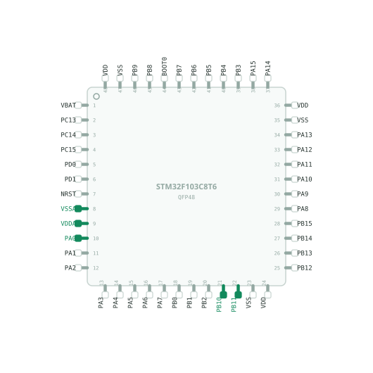

<p align="center">
  
</p>

<h1 align="center">dsh-board-lab</h1>

<p align="center">
  Плагин DeepSeek Harness, который даёт агенту плату: прошить, прочитать UART, поймать панику,
  прогнать сценарий — и всё это не отключая устройство.
</p>

<p align="center">
  <a href="LICENSE"></a>
  = 20">
  
</p>

<p align="center">
  
</p>

## Что это

Одна замкнутая петля вместо ручного перетыкания кабеля: `board_flash` собирает и заливает проект,
монитор держит порт открытым между вызовами, `board_monitor read` отдаёт только новые байты, а
`board_decode` превращает адрес паники в файл и строку. Панель «Лаборатория плат» в Web UI
показывает то же самое человеку, и агент с панелью не мешают друг другу — у них раздельные курсоры.

Поддерживаются ESP32 / ESP32-S2 / ESP32-S3 (PlatformIO + esptool), Arduino AVR — Uno, Nano, Mega
(PlatformIO + avrdude), STM32 F1/F4/G0/G4/L4/H7 (PlatformIO + ST-Link / DFU / J-Link / OpenOCD)
и Artery AT32F403A/407 (GCC + Makefile, J-Link / ST-Link / CMSIS-DAP / DFU).

## Макет из таблицы даташита

Раньше макет приходилось объяснять словами или скриншотом. Теперь у чипа нет картинки и нет
координат: есть корпус и список ножек.

| было | стало |
|---|---|
| фото платы, координаты на глаз | `package` + `pins`, геометрию считает рендерер |
| ножка = имя (`GND` × 4 схлопывались) | ножка = номер, имя — подпись |
| «сверено», потому что быстро | `verified: false`, пока не сверено с даташитом |

Достаточно вставить в панель таблицу из даташита (номер, имя, функции) — плагин разберёт колонки,
отбросит `I/O`, `FT`, напряжения и прозу, откажется от таблицы с пропущенными ножками и соберёт
макет. То же из кода:

```bash
# из таблицы, скопированной из PDF
node tools/import-pinout.mjs --table pins.txt --id stm32f103c8t6 --name STM32F103C8T6 --kind qfp --write

# из данных stm32-data (настоящие AF: PB10 → I2C2_SCL, TIM2_CH3, USART3_TX)
node tools/import-pinout.mjs --stm32 STM32F103C8.json --id stm32f103c8t6 --kind qfp --write

# посмотреть макет картинкой — та же геометрия, что в панели
node tools/map-svg.mjs maps/stm32f103c8t6.json --wired 8,9,10 --out chip.svg
```

Файл макета читается человеком: `package: {kind}`, `pins` по порядку (индекс 0 — ножка 1),
`funcs` по номерам, `verified`. Платы остались на `sides` (две гребёнки) или `draw` (корпус
прямоугольниками). Подключения лежат в `.board-lab/wiring.json` и ключуются номером, поэтому
четыре GND — четыре разных ножки.

## Инструменты

| инструмент | назначение |
|---|---|
| `board_ports` | список портов, USB id, by-id |
| `board_build` | сборка проекта PlatformIO или `make` |
| `board_flash` | прошивка; без `project` — по определённой плате |
| `board_monitor` | постоянный монитор: start / read / stop / status; `read` с `lines` — хвост лога |
| `board_write` | строка в устройство через уже открытый порт |
| `board_watch` | ждать regex в новом выводе (READY, PONG, panic) |
| `board_info` | чип, flash, PSRAM, MAC |
| `board_decode` | адреса паники → функция и строка через `addr2line` |
| `board_detect` | определить плату и подсказать проект/окружение |
| `board_project` | текущий проект: показать, закрепить, открыть папку или `lib/` |
| `board_doctor` | проверить машину: PlatformIO, pyserial, probe-утилиты, порты, проект |
| `board_tools` | инвентарь инструментов и платформ с версиями; фоновая установка выбранных |
| `board_test` | прогнать `board-tests.json` проекта и получить отчёт |
| `board_cycle` | сборка → прошивка → чтение лога одним вызовом |
| `board_checkpoint` | снимок проекта: создать, показать, откатить, удалить |
| `board_maps` | макет чипа или платы: ножки с номерами, подключения, черновик из кода, новый чип из таблицы |

```text
board_ports                                  # /dev/ttyACM0, 303a:1001 (ESP32-S3 USB-JTAG)
board_flash  project=firmware/esp32s3-hello   # сборка + заливка; монитор стартует сам
board_monitor action=read port=/dev/ttyACM0 waitMs=5000
  → === ESP32-S3 board-lab hello === ... READY ... alive 0 ... alive 5
board_write  port=/dev/ttyACM0 text=PING
board_watch  port=/dev/ttyACM0 pattern=PONG timeoutMs=5000
  → matched: true, line: "PONG"              (можно параллельно с открытой панелью)
board_decode project=firmware/esp32s3-hello text="Guru Meditation Error: ... Backtrace: 0x42009ac8:..."
  → LoadProhibited on core 0 — 0x42009ac8 app_main at cores/esp32/main.cpp:89
board_cycle  project=firmware/esp32s3-hello   # всё сразу: build → flash → чтение
```

Монитор — отдельный detached-процесс, который держит порт между вызовами: `read` отдаёт только
новые байты (offset в `.board-lab/offsets.json`), `board_flash` на время заливки останавливает
монитор и перезапускает его с импульсом сброса — в следующем `read` лежит свежий boot-лог,
а не старый хвост. Сценарий `board-tests.json` — одна команда для регрессии: шаги
`flash/watch/write/absent/reset/sleep`, отчёт в `.board-lab/runs/<ts>/` и `ok: false` для CI.

## Панель «Лаборатория плат»

Слева — проект, порт, скорость и кнопки «Собрать» / «Прошить», под ними живой лог с фильтром,
быстрыми командами и переключателем монитора, внизу — прогон сценария. Справа — контрольные
точки проекта (каждая строка сама говорит, совпадает ли она с кодом сейчас) и макет на всю
оставшуюся высоту: прямоугольные платы лежат на боку, колесо мыши и перетаскивание приближают
и двигают, клик по ножке записывает сигнал, «Черновик из кода» заполняет пустое по `#define`.
Текущий проект один на всё (`.board-lab/current.json`), поэтому агент и панель видят одно и то же.

## Установка

Плагин ставится как bundle: `dsh plugin` — тонкая обёртка над pnpm в каталоге профиля.

```bash
# из склонированного каталога
git clone https://github.com/z4ebymba-official/dsh-embedded.git
dsh plugin --profile web add ./dsh-embedded

# или сразу с GitHub, без клона
dsh plugin --profile web add git+https://github.com/z4ebymba-official/dsh-embedded.git
```

Есть готовые скрипты: `./install.sh` (Linux/macOS) и `.\install.ps1` (Windows), профиль передаётся
аргументом. После установки перезапусти DSH — панель появится в сайдбаре, инструменты `board_*`
у агента. Нужен Node ≥ 20.

### DSH Desktop

Тот же bundle ставится в профиль настольного приложения:

```bash
dsh plugin --profile desktop add git+https://github.com/z4ebymba-official/dsh-embedded.git
```

Инструменты `board_*` живут на хосте и не зависят от веб-сервера: если у профиля нет панельных
маршрутов, плагин поднимается в режиме «только инструменты». PlatformIO, Python и
`arm-none-eabi-gcc` в пакет не входят: без них `board_doctor` и `board_tools` скажут, чего не
хватает, а остальные инструменты вернут понятную ошибку.

## Агент «Плата-дев»

Бандл привозит и агента под этот плагин: пресет `board-dev` — правка кода, один `node --check`,
один взгляд в UART, короткий отчёт. Из инструментов у него только `board_*` (включая
`board_cycle`, без одиночной `board_flash` и тестов), файлы, `bash` и `ask_user_question`; память,
скиллы, web, subagent и скриншоты отсечены allow-листом в [`agents/restrict.js`](agents/restrict.js).

## Требования

- DSH — профиль `web` или настольная версия; плагин ставится как bundle.
- PlatformIO Core: системный (`pio` в PATH, `~/.platformio/penv`) или локальный в
  `<workspace>/.toolchain` — его ставит `board_tools` с `action: "install"` или кнопка
  «Скачать выбранные» в настройках. sudo и bash-скриптов не нужно.
- Python из PlatformIO уже содержит pyserial и esptool — отдельно ничего ставить не надо.
- AVR/Arduino: avrdude приходит с PlatformIO (`platform = atmelavr`); драйвер CH340/FTDI — из системы.
- STM32: `platform = ststm32`; прошивка через ST-Link, DFU или J-Link. При
  `upload_protocol = stlink` (или `dfu`/`jlink`/`openocd`) serial-порт нужен только для UART.
- AT32: `make` и `arm-none-eabi-gcc` (на Windows — MSYS2).

## Настройка

Конфиг bundle-строки `board-lab` (в `cordis.patch.yml` или профиле):

- `workspaceRoot` — корень для `firmware/` и `.board-lab/`; по умолчанию вычисляется от
  расположения плагина, поэтому обычно пусто.
- `toolchainDir` — локальный тулчейн (по умолчанию `.toolchain`); если его нет, берётся PlatformIO.
- `projectsDir` — папка проектов (по умолчанию `firmware`).
- `python` — явный интерпретатор, если PlatformIO стоит нестандартно.

На Linux для serial нужны права (иначе esptool получает `Permission denied`):

```bash
sudo tee /etc/udev/rules.d/99-dsh-serial.rules >/dev/null <<'EOF'
SUBSYSTEM=="tty", ATTRS{idVendor}=="303a", MODE="0666", GROUP="plugdev"
SUBSYSTEM=="tty", ATTRS{idVendor}=="10c4", MODE="0666", GROUP="plugdev"
SUBSYSTEM=="tty", ATTRS{idVendor}=="1a86", MODE="0666", GROUP="plugdev"
SUBSYSTEM=="tty", ATTRS{idVendor}=="0403", MODE="0666", GROUP="plugdev"
EOF
sudo udevadm control --reload-rules && sudo udevadm trigger --subsystem-match=tty
```

## Проверки

Быстрый старт на новой машине — «Настройки → Инструменты для плат»: точка у каждого инструмента,
недостающие ставятся одной кнопкой. То же из агента — `board_tools`, диагностика — `board_doctor`.

```bash
node tests/client_smoke.mjs                          # регистрация панели, без браузера
node tests/plugin_contract.mjs                       # контракт инструментов и схем
python3 tests/monitor_loopback.py                    # monitor.py на pty, без железа
node tests/plugin_contract.mjs --port /dev/ttyACM0   # то же с живой платой
```

## Документация

[`docs/board-lab.md`](docs/board-lab.md) — монитор и курсоры чтения, паники, сценарии,
автоопределение, ESP32-S3 (16 МБ flash / 8 МБ PSRAM), AT32, Windows, ограничения.

## Лицензия

MIT — см. [LICENSE](LICENSE).
